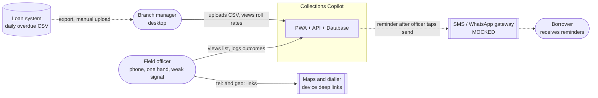
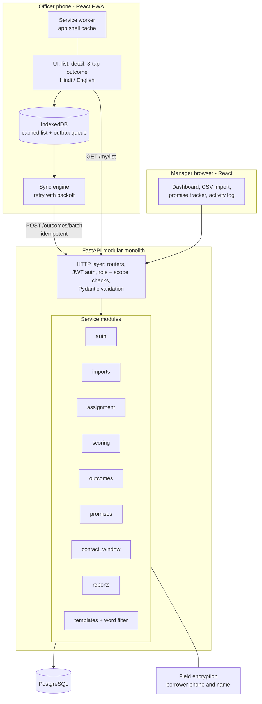
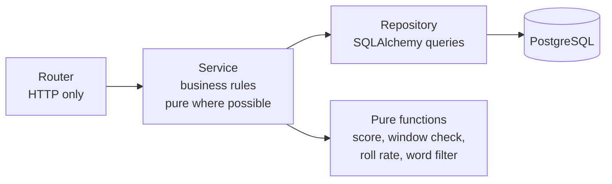
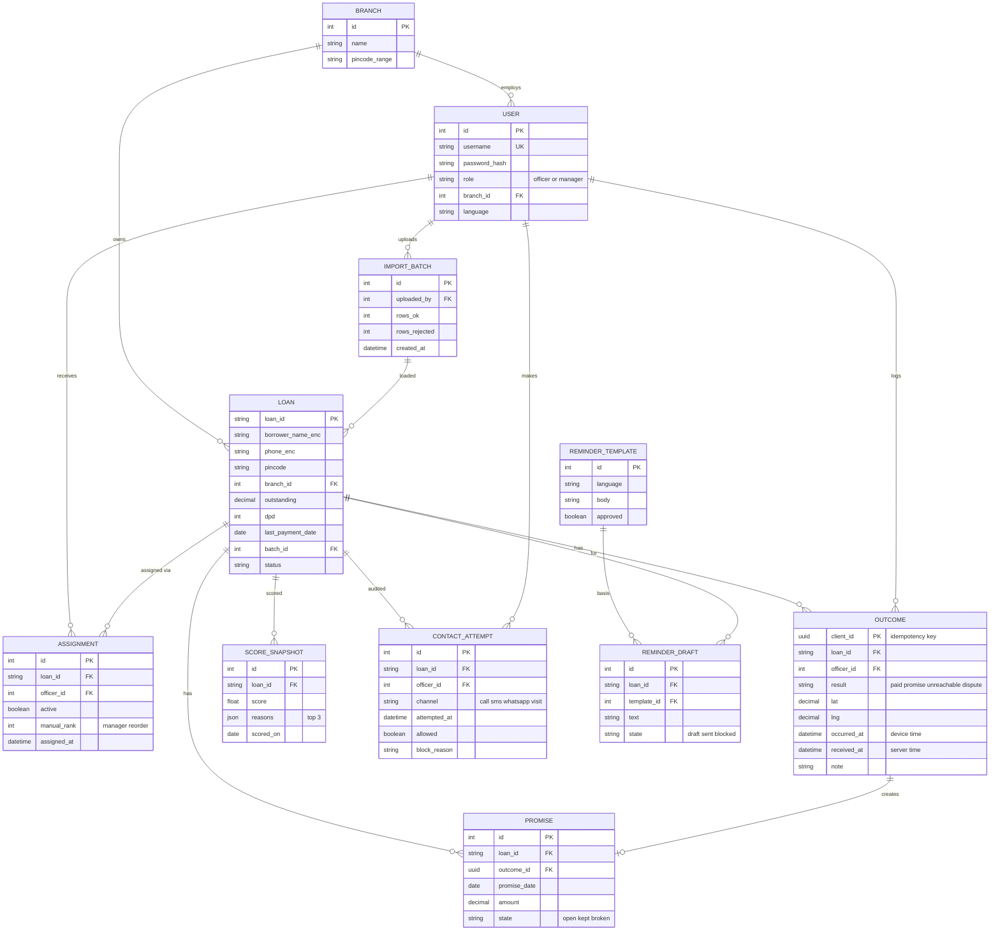
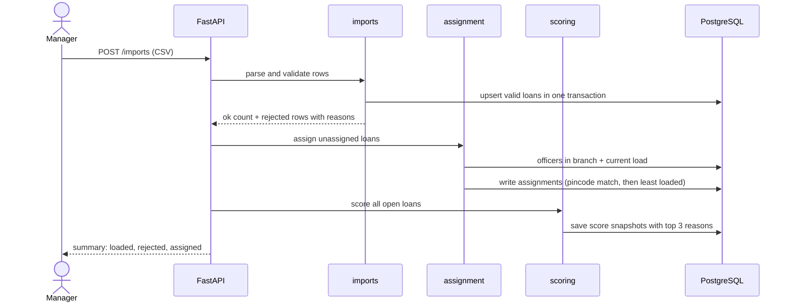
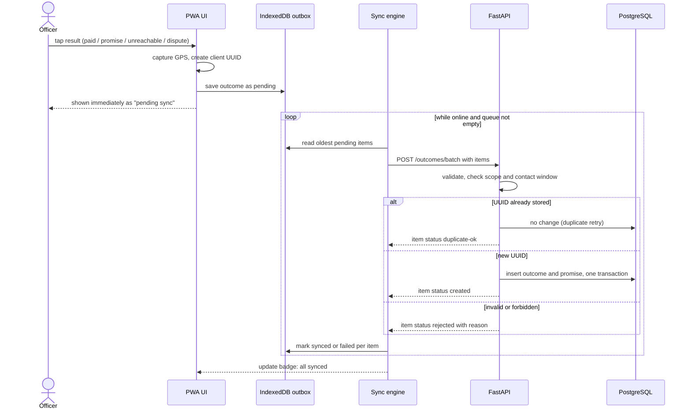
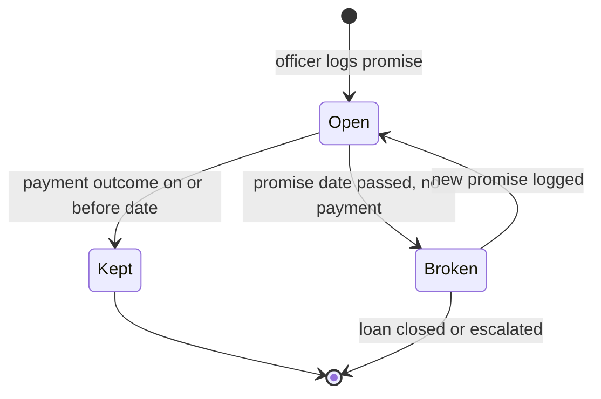
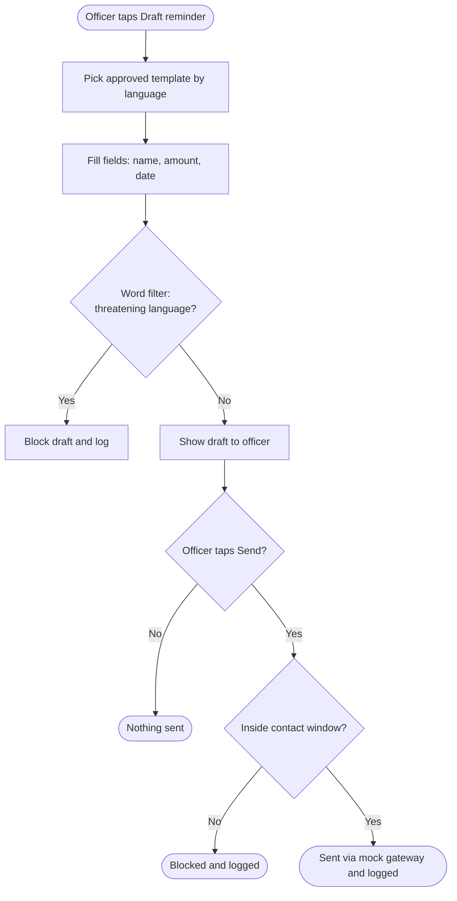
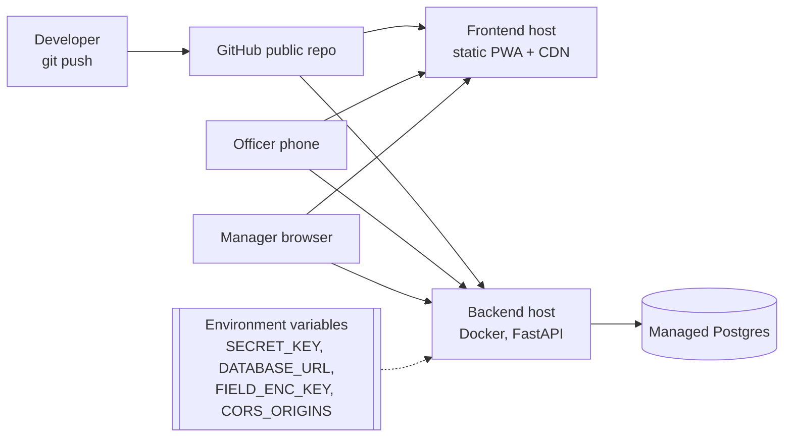

# Collections Copilot: System Design Diagrams

Assumptions are labelled A1, A2 and so on, and are listed in the TDD.

## 1. System context (who uses it, what it touches)



## 2. High-level architecture (containers)



## 3. Request layering inside the backend



Business rules never import FastAPI, so they are unit-testable without a server.

## 4. Database design (ERD)



## 5. Daily flow: import and assignment



## 6. Offline outcome logging and sync (the hard part)



Each item gets its own status, so one bad item never blocks the rest of the batch.

## 7. Contact-window rule (RBI, 8 am to 7 pm IST)

```mermaid
flowchart TD
    A([Officer taps Call or Send reminder]) --> B[Server converts now to IST]
    B --> C{08:00 <= time < 19:00?}
    C -->|Yes| D[Allow]
    C -->|No| E[Block with reason]
    D --> F[(Write contact_attempt allowed=true)]
    E --> G[(Write contact_attempt allowed=false)]
    F --> H([Open dialler / allow send])
    G --> I([Show "contact not permitted until 8 am"])
```

The server clock decides, never the phone clock. Blocked attempts are recorded too.

## 8. Promise to pay lifecycle



## 9. Reminder draft safety flow



## 10. Deployment


